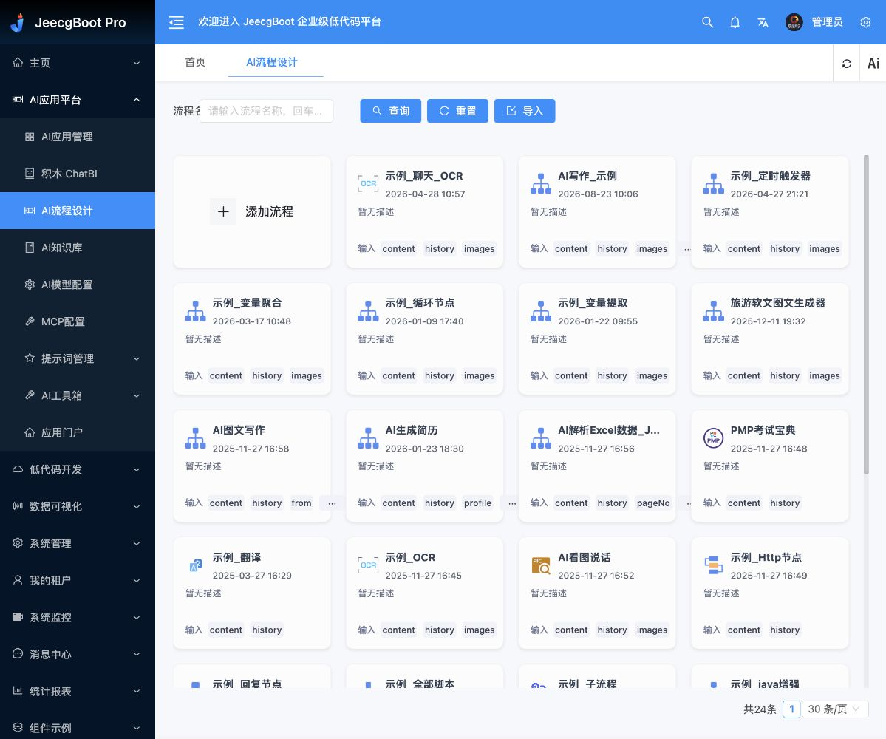
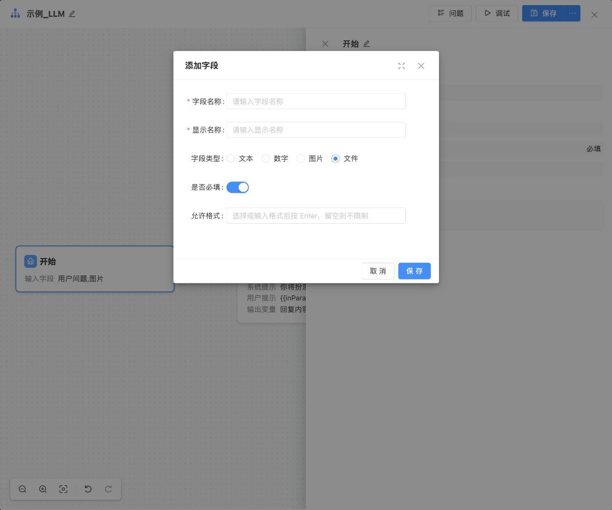

# AI Agent 编排平台项目完整记录

更新日期：2026-10-24  
记录范围：本聊天从 AI Native 产品经理闭环讨论，到平台选型、测试部署、代码可修改范围及本次归档要求。  
记录形式：按主题和时间顺序保留实质内容的结构化记录，非逐字聊天导出。账号密码、数据库凭据、SSH 密码和令牌不写入本文。

## 1. 文档索引

| 文档 | 内容 |
|---|---|
| [本项目完整记录](AI-Agent编排平台-项目完整记录-2026-10-24.md) | 需求演变、决定、实施记录、代码范围、未完成事项 |
| [总需求与思维导图](AI-Agent编排平台需求汇总-2026-10-24.md) | 平台和业务需求、候选机制、验证用例 |
| [测试环境部署说明](JeecgBoot-测试环境部署说明-2026-10-24.md) | 入口、运行目录、服务、部署验证与回退说明 |

本次同步修正总需求文档中部署前的“尚未部署”状态。早期计划与实际完成情况分别保留，避免将计划当作已实现能力。

## 2. 最初目标与讨论结论

用户最初讨论如何通过 AI Native 模式帮助产品经理完成：

接收需求 → 需求罗列 → 原型生成 → 原型调整 → 交付研发。

助手提出的思路是让需求、业务规则、原型和研发交付保持关联，修改业务规则时同步检查受影响内容，而不是各自维护相互脱节的材料。这是讨论形成的方向，不表示完整联动系统已落地。

用户随后明确指出四个前置问题：

1. AI 如何理解历史已有逻辑。
2. 用户如何输入 AI 需要理解的逻辑。
3. 用户如何输入新增需求逻辑。
4. 修改规则后，如何找出并同步受影响部分。

用户明确的解法：前三项均通过录音、逐字稿和视频输入；第四项在写代码时分析相同结构内容、受影响的关联模块，并做标记。

因此，材料理解与编码时维护关联，是用户明确要求；规则编号、关联表等具体机制仍属于实现建议。

## 3. 需求输入与逻辑理解

### 用户已明确

- 历史逻辑、当前需求和新增需求都可以通过录音、逐字稿、视频提供。
- AI 承担材料理解和需求整理工作。
- 用户不需要先完成完整 PRD 才能交给 AI。
- 编码时识别相同结构与业务影响关联，标记涉及模块，支撑后续联动修改。

### 助手提出、尚未逐项定稿的机制

- 从同一份材料中区分现有逻辑、新增逻辑、废弃逻辑和待确认问题。
- 将规则关联到录音或视频时间点、逐字稿原文位置。
- 使用稳定规则编号，建立规则、页面、接口、代码和验收案例的双向关联。
- 区分结构相似与业务规则共用：页面相似不等于权限规则相同。
- 能复用的逻辑收敛为公共实现，关联标记随代码同步维护。
- 材料存在冲突时分别记录当前实现与期望规则，不能自行猜测业务决定。

上述机制用于后续设计讨论，尚无完整系统实施证据。

## 4. 早期部署与原型假设

用户提出的初始前提是：轻量服务器、开源录音相关代码、开源转写相关代码，后两者在 GitHub 上。

在这些前提下，用户希望连接 Figma，生成不同应用原型，支持后续更改联动，并将整套逻辑实现同步到 GitHub 开源。

讨论中的技术判断与限制：

- 采集和转写之外，还需要材料理解、规则管理、版本维护、原型生成和同步能力。
- Figma 写入技术路径此前经过官方文档核实，但没有完成本项目的 Figma 连接或自动同步。
- 轻量服务器可以承担调度与平台服务；语音识别和模型是否本地运行尚未确定。
- 录音、转写仓库链接仍待用户提供。
- Figma 可编辑原型、网页交互原型，以及 Figma 手动修改后的反向同步范围尚未确认。

## 5. 平台需求明确与优先级调整

用户将方向更新为先搭建 AI Agent 编排平台，核心包括：

| 范围 | 用户要求 |
|---|---|
| 知识库 | 增量知识库、向量知识库、知识切片等核心功能 |
| Agent 编排 | 搭建 Agent 工作流 |
| 外部能力 | 编排时调用不同外部能力，例如录音转文字 |
| 验证页面 | 对不同 Agent 工作流进行验证 |
| 运行可视化 | 提供流程流转页面，展示任务执行过程 |
| 参考体验 | 腾讯 Marvis；具体页面和交互尚未确认 |
| 后续业务 | 将原来的需求输入到输出闭环放到平台中编排并展示 |

用户进一步确认建设顺序：**先建设通用平台，确保能够接入并编排外部能力，再构建需求到交付业务应用。**

“录音 Agent 专门处理录音转文字，其余也是这个思路”是用户明确给出的能力分工。助手建议底层区分固定任务工具节点与能够判断、选择工具的 Agent 节点；该区分尚未作为最终实现架构确认。

## 6. 底座选型演变

### ruoyi-vue-pro 阶段

- 最初指定仓库：[YunaiV/ruoyi-vue-pro](https://github.com/YunaiV/ruoyi-vue-pro)。
- 曾通过仓库与官方资料核对系统基础模块、AI 模块、知识库和工作流入口。
- 当时读取的 AI 工作流实现使用 TinyFlow，具有流程图保存、加载和测试执行。
- 未部署该候选，不表示它已满足完整平台需求。

### JeecgBoot 阶段

- 用户提出可以不采用 ruoyi，改评估 [jeecgboot/JeecgBoot](https://github.com/jeecgboot/JeecgBoot)。
- 用户同意 JeecgBoot 优先验证、ruoyi-vue-pro 保留候选，并要求更新总需求和验证步骤。
- 官方资料描述知识库、RAG、AI 工作流、HTTP／脚本／子流程等能力；这些说明不能替代实际部署验收。
- 随后用户明确要求在指定测试服务器部署 JeecgBoot；已完成 v3.9.5 测试部署。
- 当前状态为已有 JeecgBoot 测试实例，完整业务与所有能力的验收仍未完成。

## 7. 验证方案与已完成范围

总需求文档保留详细用例，核心顺序为：

1. 查看官方演示中的知识库、编排、运行页面。
2. 固定源码版本构建并部署。
3. 运行“录音上传 → 外部转写 → 摘要 → 展示”。
4. 验证慢任务、失败定位、重新运行与不同任务的结果隔离。
5. 验证知识新增、修改、删除后的切片和检索结果。
6. 检查源码扩展、复现部署和服务器资源。

目前已完成的是源码构建、基础部署、登录、流程列表和画布查看、文件字段配置查看。录音转写闭环、真实模型调用、知识增量和并发容量仍未完成验证。

## 8. 测试服务器部署记录

| 项目 | 本次部署记录 |
|---|---|
| 主机 | `YOUR_SERVER`，SSH 用户 `ubuntu` |
| 操作系统 | 部署时检查为 Ubuntu 24.04.4 LTS，x86_64 |
| 资源 | 约 2GB 内存、50GB 根磁盘，已有约 2GB swap |
| 既有服务 | 儿童生长评估服务，80 端口前端和 8000 端口后端 |
| 版本 | JeecgBoot tag `v3.9.5` |
| 运行方式 | Java 17 单体 JAR，systemd 托管 |
| 前端 | 本机源码构建后上传，使用 `/agent/` 子路径 |
| 平台地址 | http://YOUR_SERVER/agent/ |
| API 前缀 | `/agent-api` 代理至 `127.0.0.1:8081/jeecg-boot` |
| 运行目录 | `/opt/jeecg-agent` |
| 服务器源码 | `/home/ubuntu/jeecg-test/JeecgBoot-3.9.5` |
| 数据库 | MariaDB，独立库 `jeecg_agent` |
| 缓存 | Redis |
| 向量库 | PostgreSQL 16 + pgvector，独立库 `jeecg_vector` |
| 文件存储 | `/opt/jeecg-agent/upload`，本地存储 |
| 应用上传配置 | 单文件 200MB、请求 210MB；不代表所有文件格式已实测 |
| Java 内存 | 堆上限 512MB，尚未进行容量验收 |
| 日志 | `/opt/jeecg-agent/logs/backend.log` |
| 配置 | `/opt/jeecg-agent/config/application-prod.yml`，含凭据，本文不复制 |
| 后端服务 | `jeecg-agent.service`，已启用开机启动 |

部署过程：

- 检查资源、端口、现有服务与 sudo 能力。
- 下载固定版本官方源码；由于服务器下载较慢，另将本机下载的源码包传到服务器。
- 安装 Java、Maven、MariaDB、Redis、PostgreSQL 和 pgvector。
- 前端在本机编译，后端在服务器构建，日志记录 Maven BUILD SUCCESS，退出码 0。
- 初始化独立数据库，替换 admin 默认密码，并禁用新库中的其他样例用户。
- 设置本地上传、独立目录和较低连接池配置，停用样例定时任务自动执行。
- 初期尝试 8088 独立端口；服务器本地返回 200，但外网检查未成功，因此改用 80 端口下 `/agent/`。
- 新增路由前备份 Caddy 配置：`/etc/caddy/Caddyfile.before-jeecg-20261024151818`。
- 临时 8088 Web 服务已停用；原站点健康检查仍返回 200。
- 后端配置调整后重启，最终接口检查恢复 200。

后端 JAR SHA-256：`bf634b337c08878b73508a47951d225ab78bc3da9efdf9e54d35574c4afe9fd3`。

本机当次构建目录为 `/private/tmp/jeecg-deploy-20261024/JeecgBoot-3.9.5`。该位置是临时目录，不作为长期唯一源码副本；服务器源码仍单独保存。

## 9. 浏览器验收与文件上传问题

用户提供节点菜单截图，询问 LLM 路径是否无法满足上传方式。

讨论结论：上传入口、开始节点文件变量、外部转写调用、LLM 内容理解各有职责；节点菜单本身不能证明支持或不支持音视频上传。

早期官方开始节点说明只列文字、数字和图片，而另一文件写入说明提及 file 类型，存在资料不一致，因此要求以实际版本为准。

实际部署后的查看结果：

- 登录页在浏览器正确渲染。
- 用户明确授权填写图形验证码，完成 admin 登录验证。
- 后台 AI 平台菜单显示应用管理、流程设计、知识库、模型配置与 MCP 配置。
- AI 流程列表显示导入的 24 个官方样例，不代表本项目业务已实现。
- 可打开“示例_LLM”画布，看到开始、LLM、结束节点。
- 开始节点 → 添加字段中实际包含文本、数字、图片、文件。
- 选择“文件”后出现允许格式配置，提示留空则不限制。
- 临时配置查看后取消，没有保存对样例流程的修改。

证据：

实际音视频上传、文件白名单、外部服务读取和转写均未因此自动判定通过。

## 10. 当前代码了解范围与可修改边界

### 能明确说明的范围

- 已完成本次部署的前后端构建、环境配置、子路径与反向代理适配。
- 已定位前端 AI 页面、接口定义、后端 AI 业务模块、系统登录和密码处理代码。
- 已定位知识库、MCP、工具插件等源码入口，能够按功能继续追踪调用关系。
- 构建成功证明当前配置下的代码能够打包，不证明助手逐行阅读或理解全部源代码。

### 本次核对的代码入口

下列路径相对于源码根目录：

| 范围 | 入口 | 当前掌握程度 |
|---|---|---|
| 前端应用 | `jeecgboot-vue3/` | 已构建并适配测试访问路径 |
| AI 页面 | `jeecgboot-vue3/src/views/super/airag/` | 已定位目录，未逐页全面审查 |
| MCP 页面与接口 | `.../airag/aimcp/AiragMcpList.vue`、`AiragMcp.api.ts` | 已定位页面，读取接口定义 |
| 知识库页面 | `.../airag/aiknowledge/` | 已定位，未完成导入检索实测 |
| 包注册 | `jeecgboot-vue3/src/utils/monorepo/registerPackages.ts` | 确认动态引入 `@jeecg/aiflow` |
| AI 后端业务 | `jeecg-boot/jeecg-boot-module/jeecg-boot-module-airag/` | 本地有源码，参与服务器构建；未完整阅读全部类 |
| AI 业务实现 | `.../org/jeecg/modules/airag/llm/service/impl/` | 已定位 MCP、知识库与插件服务 |
| 文件解析与嵌入 | `.../airag/llm/handler/EmbeddingHandler.java` | 已定位，具体改动前需深入检查 |
| 系统登录 | `jeecg-boot/jeecg-module-system/jeecg-system-biz/.../LoginController.java` | 部署时检查登录与验证码处理 |
| 数据结构 | `jeecg-boot/db/jeecgboot-mysql-5.7.sql` | 用于初始化独立测试库，未审查全部业务表 |

表内 `...` 用于缩短包路径，不表示可直接复制执行的文件路径。

### 需要单独核实的依赖

- 前端流程画布引用 `@jeecg/aiflow@3.9.5-beta`。本地安装包可见 JavaScript／MJS 等分发文件；尚未确认其完整原始工程与维护构建方式。
- AI 后端 POM 引用 `org.jeecgframework.boot3:jeecg-aiflow-boot4:3.9.5`，流程引擎内部源码和扩展机制仍需专门核对。
- 因此，“已经部署”不能等同于“所有底层代码都完整掌握并可直接修改”。

### 用户提出改动后可以进行的工作

- 在已有源码范围内增加、调整或移除页面、字段、菜单、接口和业务逻辑。
- 接入转写等外部服务，开发适配接口和自定义能力。
- 按需求修改知识处理和业务工作流相关功能。
- 在变更前定位影响，处理代码、配置和必要的数据迁移，构建验证后更新测试环境。
- 涉及依赖内部时先检查扩展接口、源码与授权，再决定扩展、替换或其他实现路线。
- 隐藏菜单、关闭功能与删除历史数据属于不同操作；是否清理数据需要按具体请求确定。

本次仅记录可修改能力，不实施用户尚未指定的功能增加、删除或平台重构。

## 11. 当前未完成与待确认事项

| 项目 | 状态 |
|---|---|
| 录音与转写仓库 | 链接待提供，未接通 |
| 真实 LLM 调用 | 本次部署未配置可用凭据，未完成调用验证 |
| 嵌入模型与知识检索 | 基础服务已装，业务验证未完成 |
| 音视频上传闭环 | 文件字段 UI 已确认，真实闭环未验证 |
| 慢任务／失败恢复／隔离 | 有测试计划，未完成用例验证 |
| 全部自定义节点与引擎扩展 | 需按具体任务进一步核查 |
| Marvis 展示目标 | 产品名已确认，具体页面与交互待确认 |
| Figma 接入与反向同步 | 未接入，交付形态待确认 |
| 需求到交付应用 | 目标明确，尚未在平台内实现 |
| 规则与代码关联机制 | 原则明确，具体机制尚未实现 |
| 本项目 GitHub 开源仓库 | 尚未创建或发布 |
| 域名与 HTTPS | 尚未配置 |
| 容量与服务器升级 | 需按实际负载测量后判断 |

## 12. 实例归属与开源边界

用户询问平台是否已下载部署到自己的服务器、属于自己的平台版本。

记录答复：服务器上运行独立 JeecgBoot 实例，程序、数据库、文件和配置由用户控制，可以在此基础上发展自己的定制版本。当前版本以 v3.9.5 加部署适配为主，尚不是完成全部专属业务的产品。底层开源代码的原有权利和许可证仍需保留，不因部署到自有服务器而转移全部著作权。

后续开源的是本项目可公开的代码与部署说明；真实项目材料和凭据不随代码自动公开。

## 13. 本次续办记录

用户要求：把现有内容留存为 MD、说明代码了解程度与可增删能力、提供 admin 账号密码。

本次动作：创建本完整记录，更新总需求的部署状态，保留原部署说明与截图；检查本机源码和服务器运行状态。账号在当前聊天提供，密码不写入归档文档。本次没有改变平台业务功能。

本次服务器只读复核：服务为 active，AI 源码目录存在；平台 `/agent/` 与原服务 `/health` 均返回 200；运行 JAR 的 SHA-256 与部署记录一致。已核对管理员凭据记录，但未重新登录或执行全部业务验收。

## 14. 依据说明

- **当前聊天：**用户需求、明确授权、实际工具执行与部署结果，是本记录的主要依据。
- **知识库：**`99_收件箱/AI Native输入与规则关联-2026-10-20.md`，用于核对材料输入与编码关联方向；其中旧状态不替代本聊天的最新部署证据。
- **现有产物：**总需求文档、部署说明与两张本地截图。
- **新检查：**本机源码目录、模块 POM、前端包依赖和 MCP 接口定义，以及服务器只读检查。
- **未确认内容：**均按建议或待确认登记，不当作用户已决定的实施范围。

## 15. FlowGram 新候选评估

用户提出 [bytedance/flowgram.ai](https://github.com/bytedance/flowgram.ai)，询问能否嵌入当前平台菜单或独立部署，并判断它可能更适合本项目。本轮属于可行性与路线评估，尚未执行部署、菜单写入或原引擎替换。

本次依据：

- 官方 [框架介绍](https://flowgram.ai/guide/getting-started/introduction.html) 提供可视化画布、节点表单、变量与物料扩展能力。
- 官方 [Web Runtime 介绍](https://flowgram.ai/guide/runtime/introduction.html) 将其描述为运行时参考实现，并列出持久化、认证和接口稳定性等限制；不能直接视为完整生产平台。
- 官方 [Web Runtime 接入说明](https://flowgram.ai/guide/runtime/quick-start.html) 支持编辑器连接服务端运行时，说明可以独立部署运行服务并进行集成。
- 当前仓库另有 FlowGram Desktop：其 [README](https://github.com/bytedance/flowgram.ai/blob/main/apps/desktop/README.md) 描述 React 前端、Tauri 桌面壳与 Rust 后端；桌面项目与 Web Runtime 示例是不同路线，不能将桌面安装包直接当成浏览器菜单页。
- 本机 JeecgBoot 源码 `src/views/sys/iframe/`、`src/router/helper/routeHelper.ts` 和菜单配置存在 iframe 支持，可作为隔离接入前端的基础。

助手本轮建议，尚待用户确定实施：

1. 独立构建和部署 FlowGram Web 编排工作台，在 JeecgBoot 增加菜单入口，先采用 iframe 隔离 React 与 Vue。
2. JeecgBoot 继续提供现有账号、权限、知识库等管理能力，FlowGram 负责新的编排体验；接口共享需要开发，不会自动发生。
3. 先验证自定义文件输入、外部调用节点、流程保存重开、真实运行状态和重启后记录保留，再决定长期架构。
4. 原有流程 Schema 与 FlowGram 格式不预设兼容；需选定运行引擎或开发转换、调用适配层。
5. 嵌入页面不等于鉴权接通，仍需服务端校验；模型密钥保留在后端。
6. 服务器此前检查约 2GB 内存，静态页面与新增运行服务的资源影响分别测量。

结论：FlowGram 更值得作为本项目“可自主定制的编排层”候选验证，尚无证据证明其可以开箱替代现有整个平台。

## 16. FlowGram 独立部署与验收（2026-10-24 至 2026-10-25）

用户随后明确选择先独立部署，形成两个服务，后续再讨论接入。因此第15节的菜单嵌入仅保留为历史建议，本次没有实施。

- JeecgBoot 继续使用 http://YOUR_SERVER/agent/ ，FlowGram 使用 http://YOUR_SERVER/flowgram/ 。进程、源码目录、数据分别管理。
- FlowGram 基于官方 Web 自由布局示例与 Node.js 参考 Runtime；适配路径、服务端执行及服务器草稿保存。源码快照已留服务器，本地适配已提交，未发布到 GitHub。
- 服务端健康、认证、草稿保存读取、无效结构拒绝和 Start→End 实际运行通过；独立重启后草稿校验和一致，原 JeecgBoot 服务仍运行。
- 用户自行完成浏览器登录。Chrome 已显示用户保存的 LLM 节点，重启后刷新仍保留；Save 显示“已保存到服务器”。当前 LLM 示例配置缺少 prompt，未验证真实模型调用。
- 当前只有一份共享草稿，需手动保存；运行历史尚未持久化。音频转写、Figma、GitHub 同步、JeecgBoot 联动均未实现。
- 独立访问凭据已获得用户许可在当前聊天交付，本文不记录密码。

完整目录、版本、验证和验收步骤见 [FlowGram 独立服务部署说明](FlowGram-独立服务部署说明-2026-10-24.md)，页面证据见 [保存验证截图](./FlowGram-独立服务-保存验证-2026-10-25.png)。

## 17. JeecgBoot + FlowGram 完整接入（2026-10-25）

用户明确改为采用 JeecgBoot 管理端和 FlowGram 画布，要求鉴权、菜单、运行接口与权限接通；确认团队共享流程，管理员统一管理。功能去除范围后续提供。因此第16节的独立入口决策已进入下一阶段，不再是当前登录方式。

本轮新增“AI应用平台 → FlowGram 工作流”，复用 JeecgBoot 会话；后端实时核验 view/edit/run/manage/history 五类权限，初始只授权 admin 角色。共享草稿迁移为独立流程，原文件保留。实现多流程保存、管理归档恢复、版本冲突拦截及持久化运行报告。参考 Runtime 仍独立运行，公开接口由鉴权网关统一保护。

浏览器已完成：新菜单进入画布、迁移流程保存、新建验收流程、真实输入输出执行成功、读取运行历史。服务重启后记录保留。多角色权限与撤权通过本机及服务器隔离测试；实际负向接口检查覆盖无令牌和无效令牌拒绝，不将隔离测试写成所有真实账号都已验收。

源码提交 `9a05cf9`、`bde878e`，未推送 GitHub。现有 JeecgBoot 功能未裁剪。录音转写、真实模型、Figma、GitHub 同步不在本轮已完成清单。

完整实现、权限分配、运行限制、源码交付和回退见 [整合部署与验收](JeecgBoot-FlowGram-整合部署与验收-2026-10-25.md)。

## 18. 外部服务与付费页面盘点（2026-10-25）

用户要求挑选平台中需要外部服务或付费的页面。本轮只读导出服务器未删除的菜单/页面记录，结合前后端源码、当前本地上传配置及官方积木产品资料，整理外链、模型/能力调用、本机第三方组件、可选基础服务四类清单。明确区分免费使用、商业版差异、源码开放范围与外部API费用，不把积木组件或所有AI页面直接标为强制付费。

成果：[平台外部服务与付费依赖清单](平台外部服务与付费依赖清单-2026-10-25.md)、[完整菜单快照](JeecgBoot-菜单审计-2026-10-25.tsv)。动态配置的最终供应商、套餐、实际账单和删减选择仍待确认；没有发起收费操作或裁剪功能。

## 19. 管理员密码更新（2026-10-25）

按用户明确要求更新当前 JeecgBoot `admin` 账号密码，采用原有 PasswordUtil 算法、新随机盐，并更新密码修改时间。已重新计算并核对数据库存储结果，清除固定用户缓存；未读取会话令牌。新密码只在当前聊天交付，不写入本文或代码。此项验证不等于已通过浏览器重新登录。

## 20. 翻译开关及平台能力接口方案（2026-10-26）

用户要求在FlowGram管理端工具栏“返回列表”右侧增加“开启翻译”，给下方系统英文追加括号中文；已确认不翻译变量名、用户标题、代码、地址、提示词及运行输入输出。翻译采用本地词典和展示注释，不调用外部翻译服务，不改流程JSON。已实现开关及浏览器偏好记忆，切换不重建画布。变量/条件节点与动态菜单进行了浏览器验证，测试中新建节点未保存到用户流程。

另核实当前尚未接通JeecgBoot平台模型、知识库、提示词和MCP资源。已按现有Java控制器、Handler和Node运行接口出具对接方案，明确资源目录、后端能力适配、授权、资源版本和引用影响索引。该部分本轮仅设计，未执行真实资源调用或收费测试。

文档：[翻译需求与平台能力接口对接方案](FlowGram-翻译需求与平台能力接口对接方案-2026-10-26.md)。最终翻译源码提交 `0bf106547557fcae923481bf6dd3fdd88c66e079`，未推送GitHub。翻译已部署并完成浏览器验收，补齐多条件、必填标签、说明文案与提示布局，新增iframe版本参数和HTML缓存校验。已复核原流程版本/节点数不变，临时验收节点未保存。四类能力仍只完成方案，未实施。未裁剪现有功能。
