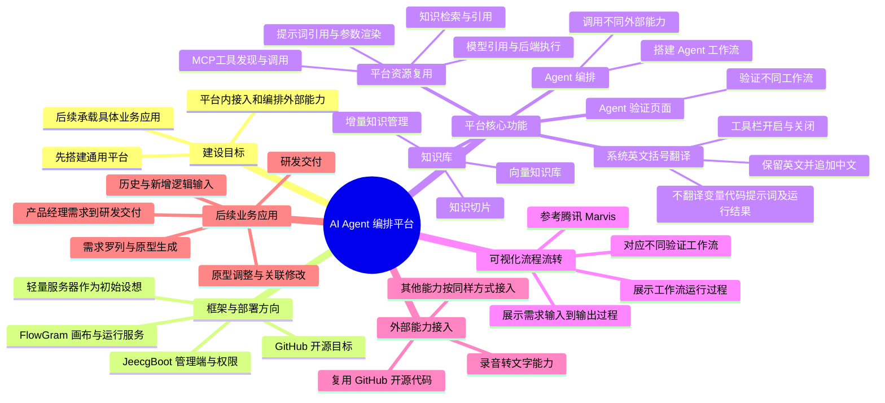
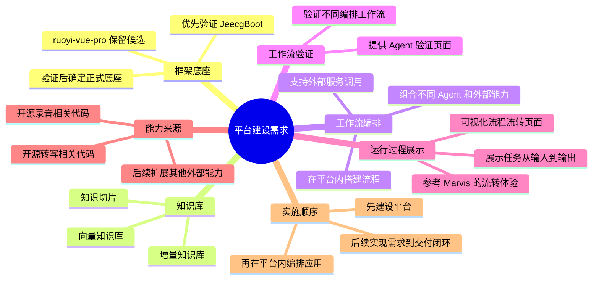
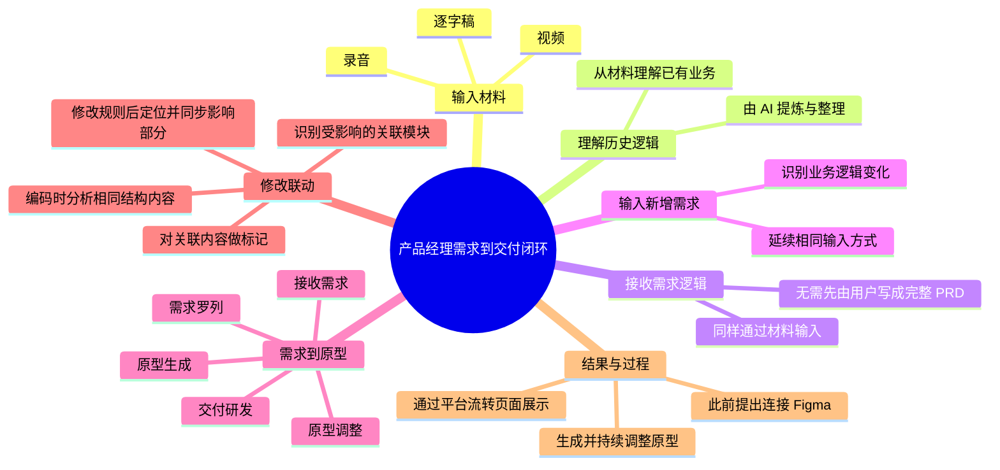
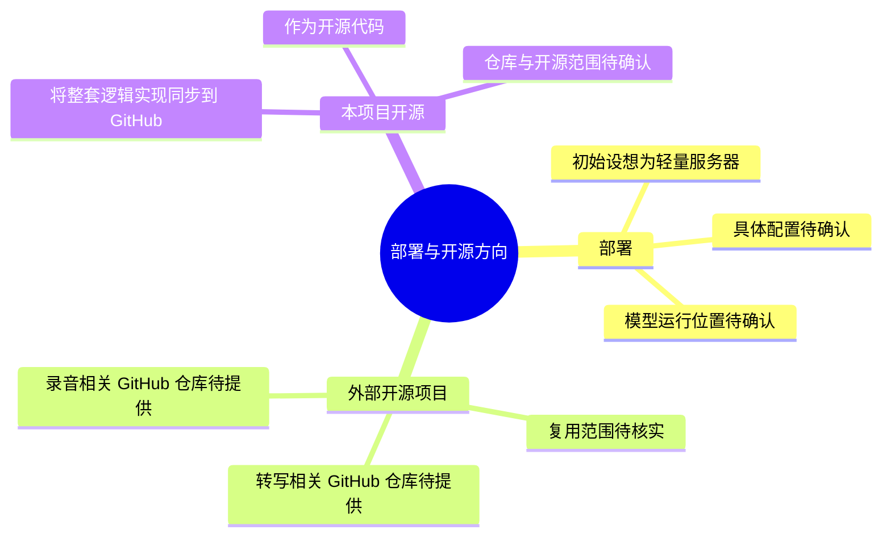
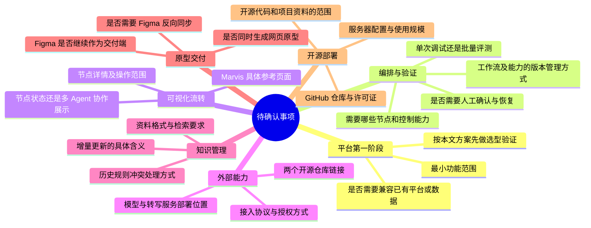

# AI Agent 编排平台需求汇总

日期：2026-10-24  
修订：V0.6，2026-10-26 增加括号翻译与平台资源接口对接需求。  
文档性质：当前对话的需求汇总，不是已实施功能清单或最终技术方案。

当前已确认实施方向：**JeecgBoot 管理端 + FlowGram 画布与运行服务**。用户要求统一鉴权、菜单内嵌、运行接口和权限；共享规则为有权限的用户共享流程、管理员统一管理。原功能去除清单后续提供，本次不裁剪。早期 ruoyi 候选与独立部署选择保留为历史，不作为当前实施方向。

最新进展：用户已明确授权部署，JeecgBoot v3.9.5 测试实例已部署并验证登录、流程列表、画布和文件字段配置。外部转写、模型调用、知识增量和完整业务尚未验证。完整记录见 [项目完整记录](AI-Agent编排平台-项目完整记录-2026-10-24.md)，运行信息见 [部署说明](JeecgBoot-测试环境部署说明-2026-10-24.md)。

本轮整合已部署：新增“AI应用平台 → FlowGram 工作流”，复用 JeecgBoot 会话，五类后端权限分别校验；共享多流程保存、归档恢复、版本冲突检测、运行与历史记录接通。浏览器真实基础执行及重启后记录保留已验证。详见 [整合部署与验收](JeecgBoot-FlowGram-整合部署与验收-2026-10-25.md)。业务闭环、真实转写和模型调用仍未完成。

2026-10-26新增：FlowGram工具栏括号翻译开关已部署，保留系统英文并追加中文，不改用户变量、节点标题、代码、提示词及输出。平台模型、知识库、提示词与MCP复用已出具 [接口对接方案](FlowGram-翻译需求与平台能力接口对接方案-2026-10-26.md)，该部分尚未实施。

## 1. 需求总览思维导图

历史阶段：FlowGram 曾先作为第二套独立服务部署并验收，随后按用户新决定接入 JeecgBoot。当前从 `/agent/flowgram/workspace` 统一进入。录音转写、自定义外部能力、知识库及需求到原型闭环仍属后续范围。接入前记录见 [FlowGram 独立部署与验证](FlowGram-独立服务部署说明-2026-10-24.md)，当前以整合部署文档为准。

## 2. 平台建设需求思维导图

以下为用户已明确的建设方向。具体交互、数据结构与执行机制尚未定稿。

优先验证框架：[jeecgboot/JeecgBoot](https://github.com/jeecgboot/JeecgBoot)。原候选：[YunaiV/ruoyi-vue-pro](https://github.com/YunaiV/ruoyi-vue-pro)。

选型关注：知识库、外部能力接入、工作流编排与验证、运行过程展示，以及源码扩展和后续开源的可行性。不能仅凭官方演示或功能介绍判定通过。

参考产品：[腾讯 Marvis]()。用户已确认产品名称；具体参考页面、布局和交互尚未明确。

## 3. 后续应用需求思维导图

以下需求保留为平台后续承载的业务目标，不代表全部纳入平台第一阶段。

## 4. 外部能力调用需求

用户已明确：平台内编排 AI 时，应能调用不同外部能力。录音转文字是已给出的具体例子，其余能力采用相同接入思路。

| 项目 | 当前要求或边界 |
|---|---|
| 录音相关能力 | 复用开源代码，具体仓库未提供 |
| 转写能力 | 处理录音转文字，具体仓库未提供 |
| 能力组合 | 可在平台工作流中调用与组合 |
| 其他外部能力 | 需要具备扩展方向，具体清单未明确 |
| 外部能力实现形态 | API、MCP、独立服务等接入方式尚未选定 |

“能力／工具节点”与“Agent 节点”的底层区分，是助手提出的实现建议，不作为用户已确认的技术架构。

## 5. 开源与部署方向

## 6. 待确认事项思维导图

这些问题保留为后续设计输入，不影响本次汇总；本文不代替用户作出选择。

## 7. 已讨论但尚未确认为需求的建议

下列内容是助手在讨论中提出的候选实现机制，不等同于用户已确认需求：

- 规则稳定编号、原始材料时间定位、规则与代码双向追溯。
- 将已确认规则与原始知识材料分别管理。
- 用实际执行事件驱动运行展示，提供节点输入输出、错误和运行记录。
- 同步／异步执行、重试、暂停恢复及版本化运行。
- 用“录音上传—转写—摘要—展示”作为首个验证流程。
- 将代码或结构化产品定义作为主数据，再同步到 Figma。

## 8. JeecgBoot 选型验证计划

### 8.1 验证范围与证据边界

目的：验证 JeecgBoot 能否作为本平台底座，以及哪些能力原生可用、哪些需要开发。先验证平台，不在本轮要求实现 Figma 或完整需求到交付业务。

按以下顺序执行：**官方演示查看 → 固定版本源码部署 → 外部调用小闭环 → 知识更新验证 → 源码扩展与资源核查 → 选型结论。**

- 官方演示只能证明该演示环境展示了相关功能，不能证明开源版本可复现。
- 模拟转写服务只能证明接口与任务流转，不能证明真实语音识别效果。
- 服务启动、接口返回和页面实际流转分别留证；页面显示成功不代表每个节点真实调用成功。
- 所有测试结果初始均为“未执行”。不预设平台一定支持重试、暂停恢复等行为。

### 8.2 准备材料与环境

| 准备项 | 内容 | 责任分工建议 |
|---|---|---|
| 官方演示 | 从 JeecgBoot 主仓库 README 的官方演示入口进入，查看 AI 应用、知识库、流程编排及运行结果页面 | 用户观察产品体验，技术人员记录实际功能 |
| 固定源码版本 | 选择具体 tag 或 commit，记录前后端版本、数据库脚本和依赖版本，避免仅记录 main | 技术人员 |
| 验证环境 | 本机或测试服务器；记录 CPU、内存、磁盘、部署方式和依赖服务 | 技术人员；服务器参数尚待提供 |
| 模型 | 一项可用模型连接及其配置，凭据通过私有配置注入 | 用户提供可用服务或技术人员配置 |
| 测试录音 | 一段约 1—3 分钟的合成业务录音，包含明确事项、日期和负责人；准备人工校对稿 | 用户可录制；不需要真实客户材料 |
| 外部转写服务 | 现有开源项目或测试服务的调用地址、授权方法、文件输入方式及响应示例 | 两个 GitHub 仓库仍待提供；技术人员适配 |
| 知识材料 | 三份合成文档：初始规则 A、新增规则 B、修订规则 A2 | 按下文样例准备 |

尚无真实转写服务时，可先接入测试服务返回固定文本，但必须标记为“模拟能力”；随后替换为真实转写并重新验证。

### 8.3 第一步：在官方演示检查产品覆盖

按实际菜单查找以下入口，菜单名称可能因版本不同而变化：

1. 新建知识库、导入文档、查看解析和切片、检索或问答。
2. 新建 AI 工作流，确认能否添加 HTTP、模型、分支、知识检索等所需节点。
3. 配置前后节点的变量引用，尝试保存并测试。
4. 查看运行过程：是否能看到节点状态、输入输出和失败原因。

输出一张差距表，逐项记录“找到／未找到／无权限／无法判断”。公共演示不允许保存或调用外部服务时，记为环境限制，转到自部署环境验证，不据此判定能力缺失。

### 8.4 第二步：由源码复现运行环境

依据选定版本的官方启动文档完成部署；优先尝试单体部署作为轻量环境验证方案，最终是否采用由测量结果决定。

通过条件：能从固定版本源码构建前后端、初始化数据库并登录；AI 模型配置、知识库与工作流页面可访问；依赖来源和启动步骤有记录。

特别核查 AI 核心模块：官方仓库此前核对到通过 Maven 引入 `jeecg-boot-module-airag`。需定位该版本的对应源码与许可证，确认能否构建、修改并接入运行。不能把能下载依赖包等同于掌握完整源码。

### 8.5 第三步：验证一个外部调用闭环

目标流程：**上传录音 → 调用外部转写服务 → 提取逐字稿字段 → 调用模型生成摘要 → 展示逐字稿和摘要。**

操作步骤：

1. 配置录音文件输入，确认节点获得的是文件本身、存储标识还是可访问地址。
2. 添加外部调用节点，按转写服务协议传入文件和必要参数。服务返回任务 ID 时，用适配节点或子流程查询任务；不假定一个普通 HTTP 节点会自动处理异步任务。
3. 将响应中的逐字稿字段映射到摘要节点，要求摘要输出事项、负责人、日期、待确认信息；没有提到的信息标记未说明。
4. 输出原始逐字稿和摘要，保存流程，运行后检查每个节点的真实调用结果。
5. 使用另一段录音再次运行，检查结果和文件是否串用。

| 测试 | 怎么操作 | 通过条件 | 保留证据 |
|---|---|---|---|
| V01 正常调用 | 上传录音并运行 | 外部服务确实收到文件；逐字稿传入模型；结果对应本次输入 | 流程配置、服务请求记录、运行页面和结果 |
| V02 长任务 | 使用实际耗时任务；也可模拟等待约 60—120 秒 | 等待期间状态准确；任务完成后继续执行。超时必须显式报错，不能假成功 | 状态变化录屏、任务 ID、开始结束时间 |
| V03 失败定位 | 用错误授权或让测试服务返回错误 | 明确指出失败节点与原因，不继续生成伪造成功结果 | 错误页面与服务响应 |
| V04 失败后重跑 | 修复错误后重新执行 | 能完成重跑；记录是全流程重跑还是失败节点重试；不混入上次输出 | 两次运行记录及产物 |
| V05 结果隔离 | 用两段不同录音运行 | 每次输入、输出和执行记录可以对应，结果不串用 | 两组文件与运行标识 |
| V06 内容准确 | 对照人工校对稿 | 关键事项、日期和负责人未被漏掉或捏造；识别错误与摘要错误分别登记 | 人工对照表 |

长任务、失败恢复等结果用于评估补建成本；测试不通过时记录差距，不伪称原生支持。单节点重试尚非已确认的第一阶段硬性要求。

### 8.6 第四步：验证知识库增量与索引一致性

以下均为合成测试规则，不代表用户真实业务：

- A：`测试项目 X：负责人接受申请之前允许修改日期，接受后不允许修改。`
- B：`测试项目 X：取消申请必须填写取消原因。`
- A2：`测试项目 X：负责人接受申请之前允许修改日期；接受后须经管理员处理改期。`

| 测试 | 怎么操作 | 通过条件 | 注意事项 |
|---|---|---|---|
| K01 初次入库 | 导入 A，查看文档、切片与检索结果 | 能定位原文与相关切片，相关问题返回 A 的依据 | 不以模型凭常识答对代替检索证据 |
| K02 新增知识 | 新增 B，再分别检索 A 和 B | B 生效，A 仍可检索；检查索引任务是否仅处理必要范围 | 仅问答正确不能证明真正增量索引，需看日志或源码 |
| K03 修订替换 | 按平台机制更新 A 为 A2 | 在当前有效知识范围内返回 A2，旧 A 不再作为现行规则引用 | 若设计为保留历史版本，应检查有效版本过滤 |
| K04 删除知识 | 删除 B，等待索引处理完成后检索 | 活跃索引与引用中不再返回 B；历史审计保留情况另记 | 新建对话并检查检索结果，避免旧上下文干扰 |
| K05 切片维护 | 检查切片来源、启停、修改及重建入口 | 记录哪些原生支持、哪些需开发 | 不把全部操作预设为已有功能 |

### 8.7 第五步：验证可视化、扩展与轻量部署

- **运行展示：**同时观察页面和服务日志，确认节点状态随实际执行变化；点击节点查看真实输入输出。记录等待、失败、结束的表现以及刷新后的记录保留情况。
- **外部能力复用：**增加第二项简单外部能力，验证是否能通过相同接入方式编排，记录需要配置还是必须改平台源码。
- **源码扩展：**定位编排、节点执行与运行事件代码；做一个最小自定义节点或状态事件扩展，重新构建并运行验证。
- **开源可交付性：**整理所用模块的源码位置、版本、许可证、外部服务及必须依赖的制品仓库；让另一套干净环境按说明复现。
- **资源测量：**记录空闲、一次任务、两个同时任务时的 CPU、峰值内存、磁盘与响应；注明转写和模型在本机还是外部运行。并发数仅为验证工况，正式容量标准待确认。
- **Marvis 对照：**由用户提供具体参考页面后再比对体验；现阶段只验证真实流程展示能力，不声称已达到 Marvis 的交互效果。

### 8.8 验证结果记录与选型条件

每项填写：`测试编号｜源码版本｜环境｜输入材料｜预期｜实际｜证据路径｜结论｜补建工作`。

结论仅使用：**通过／部分通过需补建／不通过／环境受限／未执行**。

建议选用条件：核心源码与扩展路径可获得，外部调用和变量传递可跑通，知识导入检索可复现，执行状态真实可观察；其余差距有明确补建方案，且部署资源符合后续确认的预算。若核心 AI 模块无法修改或自部署无法复现，应先解决阻碍，再决定是否采用。具体容量和转写准确率的量化门槛待确认。

验证状态更新：**源码构建、基础部署、admin 登录、AI 流程列表与画布查看、开始节点文件字段配置查看已完成**。V01—V06、K01—K05、源码扩展改动和容量验证尚未完成，不能以基础部署替代这些用例通过。具体证据见部署说明与项目完整记录。

## 9. 依据与当前状态

- **当前对话依据：**先建设通用 AI 平台，接入外部能力，支持编排、验证及可视化流转，后续承载需求到交付应用。最新实施方向为 JeecgBoot 管理端 + FlowGram，团队共享流程，按角色授权。
- **知识库依据：**`99_收件箱/AI Native输入与规则关联-2026-10-20.md`，记录材料输入、编码时维护关联，以及 Figma 等事项尚未完成实施确认。
- **本次整理：**对用户已表达内容分类、分层，并将助手建议和待确认事项单独列出；未新增已确认业务规则。
- **当前状态：**JeecgBoot v3.9.5 + FlowGram 整合已部署，菜单、会话鉴权、共享流程及运行接口已验证；外部能力、Figma、规则联动和本项目代码开源尚未完成。

### 官方核实入口

- [JeecgBoot 主仓库与启动入口](https://github.com/jeecgboot/JeecgBoot)：官方列有演示、单体启动和 Docker 启动文档；实施时按固定版本核对。
- [AI 平台说明](https://github.com/jeecgboot/JeecgBoot/blob/main/README-AI.md)：官方描述知识库、流程编排、HTTP 等节点和运行查看；不替代本地验证。
- [AI 模块依赖位置](https://github.com/jeecgboot/JeecgBoot/blob/main/jeecg-boot/jeecg-module-system/jeecg-system-biz/pom.xml)：核查 `jeecg-boot-module-airag` 对应版本的源码与可扩展性。
- [主仓库许可证](https://github.com/jeecgboot/JeecgBoot/blob/main/LICENSE)：主仓库为 Apache-2.0，依赖模块需分别核查。

阅读说明：文档使用 Mermaid `mindmap` 语法；在支持该语法的 Markdown 阅读器中可显示为思维导图，其他编辑器会显示可编辑源码。
