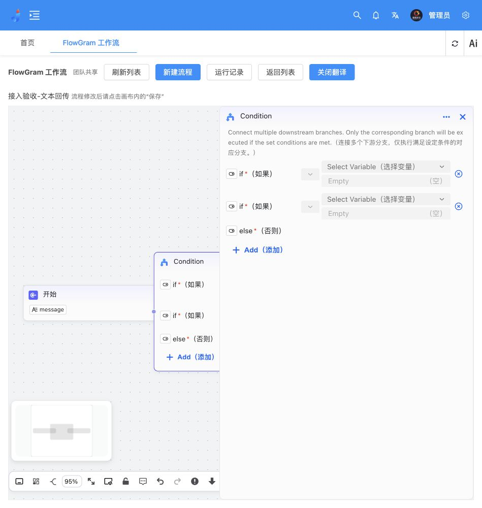

# FlowGram 翻译需求与平台能力接口对接方案

日期：2026-10-26。状态：翻译开关已部署并完成浏览器验收；四类能力接入为方案，尚未开发上线。

## 1. 用户确认的新增需求

1. 在截图“返回列表”右侧红框位置增加“开启翻译”按钮。开启后，下面流程编辑区域的系统英文增加括号中文，例如 `Test Run（试运行）`。关闭恢复原界面。
2. 用户已确认只翻译系统界面文案。变量名、节点自定义标题、代码、URL、提示词内容、输入值和模型/工具输出保留原文。
3. 核实 FlowGram 能否使用当前 JeecgBoot 中的 MCP、提示词、AI知识库、AI模型，并出具接口对接方案。本轮不把方案写成已实现。

## 2. 依据与当前事实

Vault 检索没有找到本项目四类能力接入的专项实施记录；其他项目的提示词笔记不作为本项目接口依据。当前对话、已交付接入源码和本地 JeecgBoot v3.9.5 源码为本次依据，未调用收费模型或真实工具验证。

目前接通的是菜单、登录会话、权限、流程保存、基础运行和运行记录。FlowGram 仍使用独立 Node Runtime。现有网关源码没有平台模型、提示词、知识库或MCP资源接口；FlowGram示例LLM仍使用自己的节点参数，不会自动读取JeecgBoot资源。

所以用户判断成立：**管理端已有资源不等于FlowGram节点已经可以选择并调用它们。** 手工填写HTTP或模型连接参数也不等于复用了平台资源管理与权限。

## 3. 翻译交互与验收

- 位置：管理端工具栏“返回列表”后面，画布外部。
- 默认关闭；开启显示“关闭翻译”，保留本浏览器的开关偏好。
- 范围：节点选择菜单、系统描述、按钮、条件操作、选择提示、参数类型、运行面板等系统标签。用户内容区域明确排除。
- 采用本地词典，不把界面或业务内容发给外部翻译API。
- 保留系统英文文本，中文为展示注释；占位提示可显示双语，输入value不变化。节点/变量内部ID、枚举、请求参数、模型提示词和流程JSON不翻译。
- 切换通过同源、校验来源的消息通知iframe；保持画布实例、选中节点、侧栏、缩放和未保存编辑。
- 验收：开关可逆；变量侧栏、条件节点、添加节点菜单、运行面板显示双语；新增弹层也生效；输入输出和自定义标题不被翻译；切换不提交保存、不重载画布。
- 未覆盖的系统文案补充词典和明确展示位置，不使用对用户内容的自动猜测翻译兜底。

## 4. 四类能力的源码核对

以下为JeecgBoot控制器内部路径；浏览器当前统一前缀为 `/agent-api`，后端上下文为 `/jeecg-boot`。这些现有管理接口不是统一的FlowGram执行协议。

| 能力 | 已存在的代码/接口 | 可复用部分 | 必须新增或适配 |
|---|---|---|---|
| AI模型 | `/airag/airagModel/list`、`/detail?id=...`；`AIChatHandler.chat(modelId, messages, params)` | 模型配置、供应商适配、后端对话调用 | 安全元数据目录、资源使用授权、面向节点的调用包装、超时和取消映射 |
| AI知识库 | `/airag/knowledge/list`、`/embedding/search`，以及 `EmbeddingHandler` | 知识库管理、嵌入检索实现 | 权限范围过滤、POST检索适配、统一切片与引用输出、就绪状态校验 |
| 提示词 | `/airag/prompts/list`、`/queryById`、`/experiment` | 提示词存储和已有调试能力 | 参数解析/渲染、快照或版本绑定、必填变量校验、节点引用 |
| MCP | `/airag/airagMcp/list`、`/queryById`、`/sync/{id}`等；`AiragMcpServiceImpl`建立MCP连接 | 服务配置、工具发现/同步、现有MCP客户端逻辑 | 独立工具执行适配、参数Schema、工具级授权、取消及副作用控制 |

注意：模型 `/detail` 代码显式移除了 `credential`；对接时仍应使用新DTO白名单返回元数据，不直接返回完整模型或MCP实体。MCP的“同步工具列表”不能当成“执行工具”。现有检索接口存在不等于已经有满足本方案的数据权限校验。

## 5. 建议结构

```text
JeecgBoot资源配置页（唯一配置来源）
       ↓
FlowGram节点资源选择器 ← 鉴权网关 ← JeecgBoot安全元数据目录
       ↓ 保存资源ID、参数映射及修订引用，不保存密钥
FlowGram运行提交 → 网关校验用户/流程/资源 → Node Runtime调度
       ↓ 受约束的运行上下文，不是用户可编辑的节点参数
Java能力适配接口 → 原模型Handler / 提示词服务 / EmbeddingHandler / MCP客户端
       ↓
统一节点输出、引用和执行报告 → 网关持久化 → 画布与运行记录
```

建议在现有Java业务模块内增加FlowGram能力适配Controller/Service，在现有Node网关和Runtime中增加调用上下文与节点适配。不再创建第二套模型、知识库或MCP配置数据库，也不直接让浏览器使用供应商密钥。

四类节点建议：平台大模型、平台知识检索、平台提示词、平台MCP工具。保留原有节点，已有流程不自动转换，平台节点通过明确操作绑定资源。

## 6. 拟新增的接口契约

**本节全部为拟新增接口，当前线上不存在。** 路径与字段为本次方案，实施时纳入OpenAPI并做版本管理。现有网关Caddy匹配规则也需增加资源路径，不能只写前端请求。

### 6.1 前端可调用的资源目录

| 网关接口 | 返回内容 |
|---|---|
| `GET /flowgram/resources/models` | 可使用模型的id、名称、类型、支持能力、可用状态、revision |
| `GET /flowgram/resources/prompts` | 可使用提示词的id、名称、参数名、revision |
| `GET /flowgram/resources/knowledge` | 可检索知识库的id、名称、就绪状态、revision |
| `GET /flowgram/resources/mcp` | 可调用服务的id、名称、连接状态 |
| `GET /flowgram/resources/mcp/{id}/tools` | 可调用工具名、说明、inputSchema、outputSchema（若提供）、副作用标记、revision |

目录由Java服务按当前用户筛选，网关不直接转发原实体；列表分页、搜索，区分无权限、资源已停用和服务不可达。提示词内容仅按资源权限返回，执行时以服务器快照为准。

### 6.2 后端能力适配接口

建议Java新增内部 `/flowgram/bridge/v1/...`，由Runtime受控调用；不作为可匿名访问的通用代理。

| 适配接口 | 主要输入 | 统一输出 |
|---|---|---|
| `POST /models/chat` | modelId、messages、允许的生成参数 | text、结构化内容、usage（供应商提供时）、finishReason |
| `POST /prompts/render` | promptId、期望修订、variables | messages或text、实际修订、所需变量 |
| `POST /knowledge/search` | knowledgeIds、query、topK、scoreThreshold | context、chunks、citations、实际检索配置 |
| `POST /mcp/call` | mcpId、toolName、arguments、工具修订 | content、structuredContent（若提供）、isError |

每次调用携带可信运行上下文：runId、nodeId、调用编号、用户身份引用和截止时间。上下文由网关验证后签发，不能信任前端提交的username/permissions。

第一版可由异步工作流任务包住非流式节点返回；模型Handler内部若使用流式TokenStream，应由Java适配层收集并处理超时/取消，不能直接把Java响应流当成普通JSON。节点逐字流式展示作为后续扩展。

示例：平台大模型节点持久化结构（示意，非现有Schema）：

```json
{
  "type": "platform-llm",
  "data": {
    "resourceRef": { "kind": "model", "id": "model-id", "revision": "resource-revision" },
    "promptRef": { "id": "prompt-id", "revision": "prompt-revision" },
    "bindings": { "transcript": { "type": "ref", "content": ["previous-node", "text"] } },
    "parameters": { "temperature": 0.3 }
  }
}
```

这里只保存引用和映射，不保存API Key、MCP认证头或完整服务地址。节点执行器读取上一步输出绑定变量，再调用Java能力服务。

## 7. 鉴权、版本和运行语义

### 资源使用权限

- 沿用现有 `flowgram:view/edit/run/manage/history`；另外建议设置模型使用、提示词使用、知识检索、MCP工具调用权限，具体编码需在实施阶段与JeecgBoot现有权限表对齐。
- “可以编辑流程”不自动等于“可以调用所有模型”；“可以看模型配置页”也不自动等于“可以执行模型”。
- 执行要同时满足流程运行权限与资源使用权限。共享流程不会赋予创建者的私有资源权限；其他人运行时按自己的授权校验。
- 保存时验证引用合法，运行开始再次校验；每次外部能力调用前复核资源权限和状态，防止保存后停用/撤权仍然使用。

### 内部调用身份

- 建议短期、限定run/node/resource/tool范围的执行票据，另加服务间身份校验；Runtime不能仅凭一个长期全权限服务密钥任意调用所有能力。
- 票据由可信网关放入Runtime私有任务上下文，不能放入流程JSON、globalVariable、用户inputs或可见日志。
- 与当前用户会话关联的验证材料仅放内存；禁止读取Redis扫描令牌、从浏览器存储导出会话、或在运行记录内保存用户Token。
- 会话或资源授权失效后停止新的能力调用并返回明确状态；第一版不提供脱离登录会话的后台长期调度。服务重启后的执行恢复仍不在当前能力内。

### 版本与影响标记

- 资源不假设都已有发布版本表。第一版可用更新时间加规范化内容Hash标识修订，执行时快照所用提示词/检索配置等非密钥内容。
- 建议一次运行固定资源修订，运行过程中不自动换新提示词。引用已变化时，编辑器提示检查并明确更新；此策略是建议，待评审确认。
- 建立流程—节点—资源引用索引。资源修改或停用时列出受影响流程/节点，标记需复核；不通过字符串替换自动改动业务流程。

### 错误与副作用

- 统一错误码：资源无权限、资源停用、修订冲突、参数不合法、依赖未就绪、配额/限流、调用超时、工具失败、用户取消。
- 知识库保存成功不等于已向量化；索引未就绪应拒绝检索，保留切片ID、文档来源和引用，不能只返回拼接文本。
- 提示词变量使用明确的模板语法，缺失必填变量报错，不执行任意模板代码。
- MCP按发现的inputSchema校验，副作用工具不得自动重试；写入、发送、删除等操作的确认机制需要在实施前细化。工具返回内容不能修改平台权限或越过节点作用域。
- 运行记录保存资源引用、修订、节点耗时、引用结果和错误；密钥和认证头不记录，业务输入输出仍遵循团队历史权限。

## 8. 推荐实施顺序与验收

1. **资源目录与权限**：四类可选资源目录，验证脱敏、停用及无权限过滤，不做收费调用。
2. **模型 + 提示词**：平台节点引用ID；改平台模型配置后不再手填密钥；变量缺失、撤权、修订变化、超时和取消可见。
3. **知识检索**：检索节点输出结构化切片和引用，接入模型上下文；验证空结果、未索引、越权及真实嵌入模型。
4. **MCP工具**：先接无副作用的测试工具，再验证真实工具，补充Schema变化与副作用确认。
5. **端到端验证**：输入逐字稿 → 平台提示词 → 平台模型；或问题 → 平台知识检索 → 平台模型 → MCP工具 → 输出与报告。

逐字稿流程只证明文本输入后的调用。录音上传、音频转写、视频处理需额外接入对应能力，不因四类资源接通而自动完成。

验收至少包含：两种不同权限账号、共享流程资源授权、保存后撤权、服务停用、密钥不落前端/日志、提示词版本变更、模型失败、知识引用、MCP失败/取消、历史报告。真实调用需要用户已有可用服务和测试额度；目前没有这部分验收证据。

## 9. 交付状态与后续确认

- 翻译：已部署；两项保护性测试、TypeScript检查、代码规范检查和生产构建通过。管理端构建及配置生成通过。浏览器验证了变量侧栏、添加节点菜单、多条件分支、条件if/else必填标签、空值提示、节点说明和开关恢复，未保存节点及侧栏不会因切换丢失。
- 最终源码提交：`0bf106547557fcae923481bf6dd3fdd88c66e079`，本地提交，未推送。源码和补丁位于 `outputs/flowgram-platform/translation-2026-10-26/`，服务器源码位于 `/opt/flowgram/source`。
- 管理端iframe增加版本参数，FlowGram HTML返回 `Cache-Control: no-cache`，已核对浏览器加载新版脚本，避免旧页面缓存。截图验收时另外补齐节点说明，并修正条件标签省略及空值英文被挤压的问题。
- 保存数据复核：原共享流程仍为revision 2、3个节点；文本回传验收流程仍为revision 1、2个节点。临时新增节点未保存，验收标签页已关闭，原编辑页未被主动刷新。
- 原站点、JeecgBoot入口、FlowGram入口均返回200。没有重置账号、修改资源权限或调用收费服务。
- 部署回退：管理端初次翻译前目录 `/opt/jeecg-agent/web-before-translation-20261026094335`；最终画布发布前目录 `/opt/flowgram/web-before-translation-final-20261026142103`。存在中间测试版本，回退前按目标版本选择完整前端组合并保留后续数据，不覆盖流程文件。HTML缓存调整仅涉及FlowGram路径。
- 四类资源：本文件是源代码核对后的接口设计，尚未接通；不能把已有管理接口计作新执行接口已上线。
- 待评审：资源使用权限映射、资源修订更新策略、MCP副作用确认、可用测试模型/知识库/工具。方案评审后再实施这些部分。

代码依据：`jeecg-boot/jeecg-boot-module/jeecg-boot-module-airag/src/main/java/org/jeecg/modules/airag/` 下的 `llm/controller`、`llm/handler`、`llm/service/impl/AiragMcpServiceImpl.java`、`prompts/controller/AiragPromptsController.java`；以及本次已交付的 `flowgram-platform/jeecg-integration/gateway.mjs`。

## 10. 最终显示证据

以下为临时验收节点的显示截图；新增节点未保存到现有流程。节点标题 `Condition` 属于可编辑流程内容，按确认范围保留原文。


