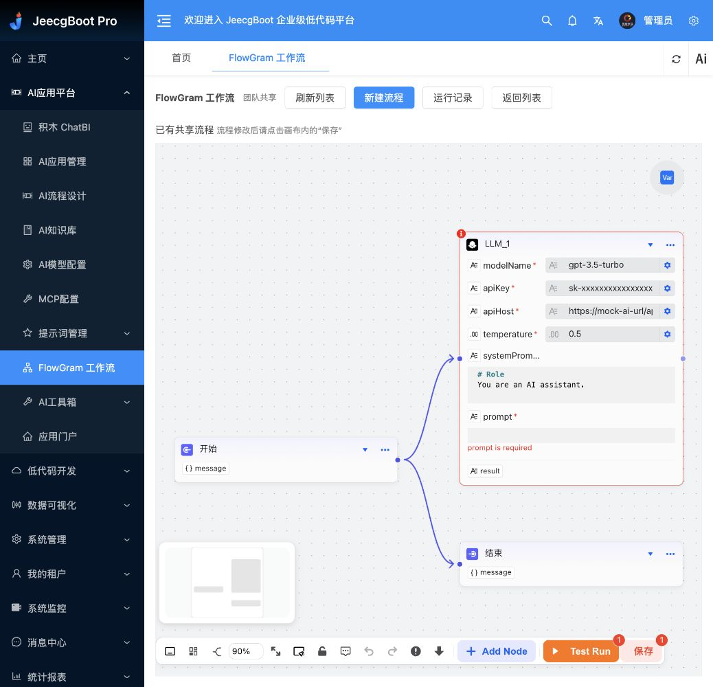
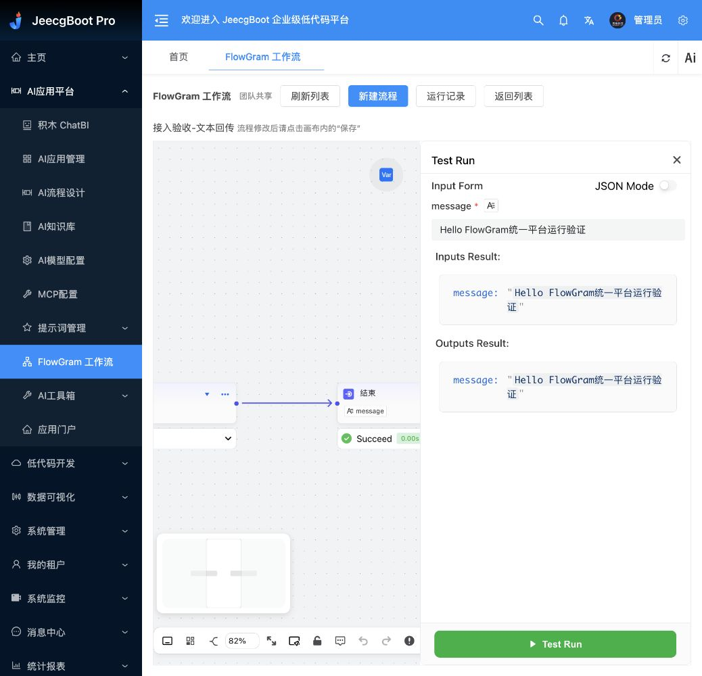
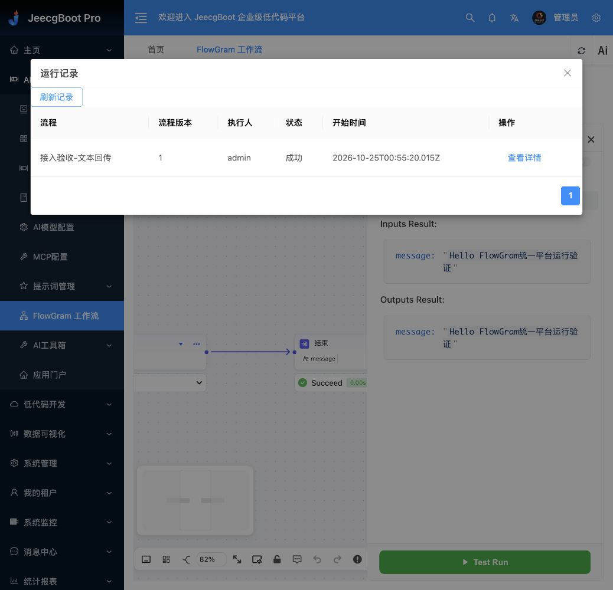

# JeecgBoot + FlowGram 整合部署与验收

日期：2026-10-25

## 已确认范围

用户确认将 JeecgBoot 管理端与 FlowGram 画布接通，覆盖菜单内嵌、统一鉴权、运行接口及权限。数据规则为：有权限的用户共享流程，管理员统一管理。原功能去除清单后续提供，本次不裁剪。

本次 Vault 检索未找到 FlowGram / JeecgBoot 专项整合笔记；以上决策来自当前对话。下述实现与验证来自当前代码、服务器与浏览器实测，不把早期建议当作已完成事实。

## 访问与使用

- 统一入口：<http://YOUR_SERVER/agent/flowgram/workspace>。
- 菜单：AI应用平台 → FlowGram 工作流。
- 使用 JeecgBoot 原有账号登录；平台内不再要求单独的 FlowGram Basic 账号。
- 如果旧页面缓存没有新菜单，刷新 JeecgBoot 页面重新加载菜单。
- 直接打开 `/flowgram/` 仅显示进入 JeecgBoot 的提示；不再作为独立编辑登录入口。

管理员当前可在列表新建、重命名、归档及恢复流程；打开画布后配置节点、手动保存与试运行。运行记录提供团队执行历史、执行人、流程版本、状态及输入输出、节点报告。

已有草稿已迁移为“已有共享流程”，原 `/opt/flowgram/data/workflow.json` 保留。新增“接入验收-文本回传”用于基础运行验收，不依赖模型凭据。

## 鉴权和权限

JeecgBoot Vue 页面通过同源 iframe 加载 FlowGram。双方核对 postMessage 的 origin 与 source，登录令牌只保存在画布内存，通过请求头发送，不写入 URL、流程或运行记录。每次 API 请求均通过 JeecgBoot 当前会话和权限接口核验，不依赖按钮隐藏来实现权限控制。

| 权限编码 | 用途 |
|---|---|
| `flowgram:view` | 进入模块、查看共享流程；其他操作也必须有此权限 |
| `flowgram:edit` | 保存流程节点、连线和变量定义 |
| `flowgram:run` | 校验、运行流程，读取及取消自己的实时任务 |
| `flowgram:manage` | 新建、重命名、归档恢复流程，以及管理他人的实时任务 |
| `flowgram:history` | 查看团队共享的持久化运行记录及详情 |

初始只向现有 `admin` 角色增加新菜单和以上权限，未向其他角色自动授权。后续由管理员在 JeecgBoot 系统管理的角色授权界面分配“AI应用平台 / FlowGram 工作流”及其操作权限。

推荐授权组合：查看者 = view；编辑者 = view + edit；运行者 = view + run；记录查看者 = view + history；流程管理员 = view + manage，并按职责增加 edit、run、history。

只有运行权限、没有编辑权限的用户，后端始终执行已保存流程，不接受客户端注入的其他流程结构。实时任务由执行人或拥有 manage 的用户操作；history 权限明确允许查看整个团队的历史结果。

当前共享范围是有权限的平台用户，尚无独立租户工作空间的数据分区；不把本实现视为租户隔离能力。

## 数据与运行

- 流程按独立编号保存，支持多个流程。
- 保存检查 revision，过期版本返回 409，避免多人编辑静默覆盖；需重新打开最新流程后再编辑。
- 归档为可恢复操作；归档流程不能运行。
- 运行记录保留执行人、流程编号/名称、保存版本、是否有未保存变更、输入输出及节点执行报告。
- 后台独立收集运行状态，浏览器关闭不影响报告收集。
- 常见密钥命名字段在持久化报告中遮蔽；自由文本可能包含业务资料，因此查看历史仍需授权。
- 运行历史保留不等于执行断点恢复。参考 Runtime 重启会丢失尚未完成的内存任务；连续查不到状态后记录为中断，需重新运行。
- 当前是单实例文件存储，没有多副本部署、历史版本回滚或数据库化的容量验收。

## 部署结构

| 部件 | 位置 / 服务 |
|---|---|
| JeecgBoot 页面 | `/opt/jeecg-agent/web` |
| JeecgBoot Java 后端 | 原 `jeecg-agent.service`，127.0.0.1:8081；未替换 JAR |
| FlowGram 页面 | `/opt/flowgram/web` |
| FlowGram Runtime | 原 `flowgram.service`，127.0.0.1:4000 |
| 新增鉴权网关 | `flowgram-gateway.service`，127.0.0.1:4001 |
| 网关源码 | `/opt/flowgram/integration/gateway.mjs` |
| FlowGram 更新后源码 | `/opt/flowgram/source` |
| 流程 | `/opt/flowgram/data/workflows/*.json` |
| 运行记录 | `/opt/flowgram/data/runs/*.json` |
| 部署产物与验证报告 | `/home/ubuntu/flowgram-test/integration` |

Caddy 将 FlowGram 的业务接口统一转至鉴权网关。旧 workspace、tRPC、文档路径不能直达原 Runtime。公开静态页面不包含流程数据，流程与运行 API 必须携带有效 JeecgBoot 会话。

仅 FlowGram 路径允许 SAMEORIGIN iframe，并使用 `frame-ancestors 'self'`；JeecgBoot 与原站点保留 `X-Frame-Options: DENY`。原站点及其接口路由未修改。

本次测量：网关约 24MB、Runtime 约 57MB、JeecgBoot 约 458MB，均 active，自动重启计数为 0。这是单次测量，不代表负载容量。

## 验证证据

| 验证层次 | 实际结果 |
|---|---|
| 前端构建 | FlowGram TypeScript 检查及生产构建通过；JeecgBoot Vite 构建和配置生成/资源复制通过 |
| 代码检查 | FlowGram 仓库 license-header、lint-staged 和 commitlint 直接运行通过；Rush 引导安装卡住，未将其当作成功 |
| 隔离权限测试 | 本机及服务器均通过：无登录、过期会话、无查看权限、只读用户禁止保存、编辑/运行/管理分离、空更新拒绝、版本冲突、归档恢复、任务归属、撤权、运行记录重启持久化 |
| 隔离测试边界 | 上述多角色与撤权用受控身份提供器测试；没有批量创建真实业务账号，也未宣称各角色都完成浏览器验收 |
| 服务器实际检查 | 无令牌和无效令牌访问业务 API 均返回 401；三个服务 active；原站点健康和 JeecgBoot 返回 200；iframe 响应头符合隔离规则 |
| 正常浏览器会话 | 已登录 JeecgBoot 后进入新菜单，无需 FlowGram 二次登录；迁移草稿显示并保存成功，列表版本更新为 2 |
| 浏览器新建与运行 | 新建“接入验收-文本回传”，真实 Start→End 执行成功，输入输出均为 `Hello FlowGram统一平台运行验证`，节点显示 Succeed |
| 浏览器运行历史 | 列表显示执行人 admin、成功；打开详情可查看输入输出和节点报告 |
| 服务重启 | 网关与 Runtime 重启后，服务器仍读到已持久化的成功记录；浏览器重新刷新历史、打开详情，仍能读取原输入输出和节点报告 |

浏览器运行任务编号：`bb4807c2-c216-4203-8139-f3200b6185dc`。验收流程编号：`d845de60-14b9-4b11-9747-29bc3542e6c6`。

本轮没有配置真实 LLM、录音转写、Figma 或 GitHub 同步；原有 LLM 示例流程仍缺少 prompt，不能用本次基础流程成功代替模型调用验收。

截图：







## 代码交付与回退

- 接入提交：`9a05cf9`；空更新校验修复：`bde878e8da5e49cfc018908589cad9ba8a8d3c4f`。本地提交，未推送 GitHub。
- 可复用代码和完整接入补丁：[jeecg-integration](./flowgram-platform/jeecg-integration/README.md)。其中包含 Vue 页面、网关、权限菜单 SQL、隔离测试、部署及只读检查脚本。
- 补丁以之前独立部署提交 `d3d01fa` 为基线。
- 部署前备份：`/home/ubuntu/flowgram-test/integration/backup-20261025085234`，含 Caddy、流程数据及权限表快照。备份仅留服务器，不公开。
- 原页面目录保留为 `/opt/flowgram/web-before-integration-20261025085234`、`/opt/jeecg-agent/web-before-integration-20261025085234`。
- 回退需同步恢复对应页面、FlowGram Caddy 区块及原 X-Frame-Options 规则；只撤销本次 `fg_*` 菜单与角色关联，不覆盖后续新建的其他权限和数据。先备份新流程与运行记录，再执行回退。

```bash
sudo systemctl status jeecg-agent flowgram flowgram-gateway
sudo journalctl -u flowgram-gateway -n 100 --no-pager
node --test /opt/flowgram/integration/gateway.test.mjs
python3 /home/ubuntu/flowgram-test/integration/check-flowgram-integration.py
```

后续待用户提供：JeecgBoot 功能裁剪清单。本轮不删除现有菜单、源码或业务数据。
